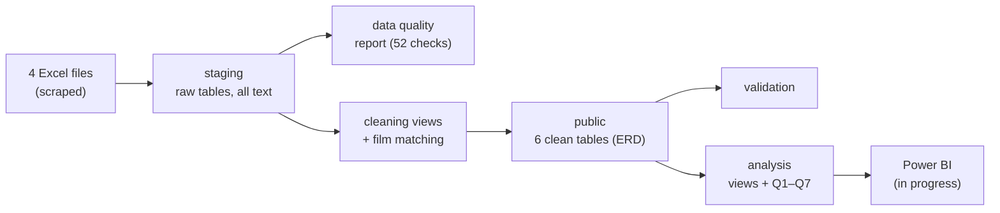
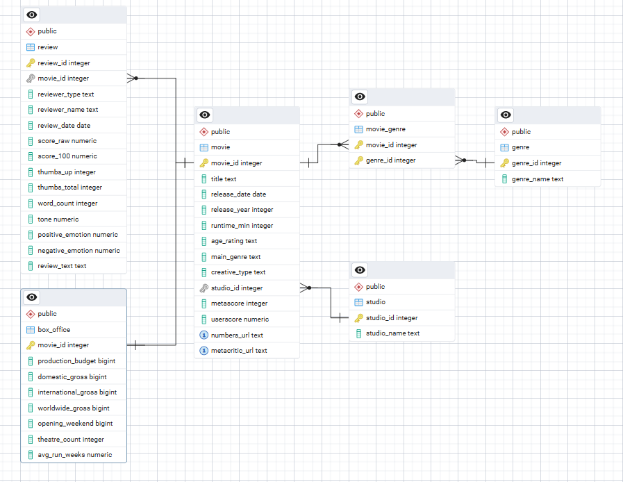

# Film Investment Analysis (SQL · PostgreSQL)

**What kind of film should a studio invest in, and how should it launch it, to get the highest box office multiple at the lowest risk?**

An end-to-end SQL project: from messy data scraped from two websites to a clean PostgreSQL database, a validated analysis and three business recommendations, with a special focus on **low-budget films (under $10M)**.

| | |
|---|---|
| **Data** | 30,612 films with box office figures (The-Numbers) + 11,364 films and 558,635 critic and user reviews (Metacritic), released 2000–2021 |
| **Tools** | PostgreSQL 17, pgAdmin 4 · Power BI dashboard *(in progress)* |
| **Skills** | Data modelling (ERD) · ELT pipeline · data quality checks · data cleaning and matching · CTEs and window functions · statistics in SQL · business recommendations |

---

## Key recommendations

**1. What to make: horror at $1–50M; avoid mid-budget drama**
- Horror is the best genre on both return and risk: a median multiple of **3.36x**, and even its weakest quarter of films earns **1.56x** its budget. It works at every type of studio.
- Best low-budget investment: **horror at $1–10M**, with **5.2x**, 81% earning back their budget and 2 in 3 reaching 2.5x (107 films).
- Avoid the most common choice in the data: **drama at $10–50M** (547 films, 1.38x, 4 in 10 lose money).
- For a studio with large capital, action or adventure at $100M+ is the safe route (2.8x, 91–93% earn back their budget), but it needs very large budgets.

**2. How to launch: a quiet month and a strong distributor**
- Release small films in **January–February** (4.3x), when there are the fewest blockbusters and releases. Avoid **May** (1.86x).
- Horror does best in **January** (4.92x, 90% earn back their budget). October gives the biggest opening, but not the best return.
- Partner with a **wide-release distributor**: the small horror films of Paramount, Universal and Warner Bros. reached 26.8x, and all 26 earned back their budget.
- Plan **internationally** for big films: over 60% of box office now comes from outside the US.

**3. Invest in quality where it pays, especially for expensive action**
- Films with critic acclaim (81+) earn **4.0x** with an 89% hit rate, against 1.58x for badly reviewed films.
- Reception matters most for **action**: check quality before committing $100M+.
- For small films, **genre, budget, release month and distributor** matter more than reviews.

> All results describe patterns in the data: they are *linked to* higher multiples, not proof of cause and effect. See [Limitations](#limitations).

---

## Business questions

| | Question | Perspective |
|---|---|---|
| Q1 | How has the international share of box office changed, and which genres earn the most abroad? | Market context |
| Q2 | Which studios achieve the best multiples, and how is their film mix different? | Market context |
| Q3 | Which genres have the highest median multiple and hit rate? | Finance: return and risk |
| Q4 | Which budget size gives the best multiple for the risk? | Finance: return and risk |
| Q5 | Which release months give the strongest opening weekends and multiples? | Marketing: launch |
| Q6 | Are better critic scores linked to higher multiples? | Marketing: reception |
| Q7 | Where do critics and audiences disagree, and which score lines up better with box office? | Marketing: reception |

Every question is answered for **all films** and for **low-budget films** side by side.

### Metrics
- **Box office multiple** = worldwide box office ÷ production budget (below 1.0x = the film did not earn back its budget)
- **Hit rate** = % of films that earned back their budget; **reached 2.5x** = a stricter break-even, because cinemas keep part of the ticket money and marketing costs are not in the data
- **Profit ($)** = worldwide box office − production budget
- Groups are compared with **medians**, not averages: a few huge hits (up to 431x) would distort averages
- Groups that are too small to be reliable (under 10 or 20 films) are hidden

---

## Data

| Source | Contents | Rows |
|---|---|---|
| [The-Numbers](https://www.the-numbers.com) | Budget, domestic / international / worldwide box office, opening weekend, genre | 30,612 films |
| [Metacritic](https://www.metacritic.com) | Studio, age rating, genres, critic score (metascore), user score | 11,364 films |
| Metacritic | Critic reviews (+ text-analysis scores) | 238,973 reviews |
| Metacritic | User reviews (+ text-analysis scores) | 319,662 reviews |

The data was collected by web scraping in a group university project. **The database design, data cleaning, SQL and analysis are my own work.**
The data itself is **not included** in this repository: it belongs to the two websites, and the user reviews contain usernames (personal data).

---

## Approach: an ELT pipeline in PostgreSQL

The raw data is loaded **as it is** into a `staging` schema and cleaned **inside the database with SQL** (Extract → Load → Transform). The raw data is never changed, so every cleaning rule can be fixed and re-run. All scripts are **idempotent**: safe to run more than once.

| Script | Step |
|---|---|
| [`01_staging_tables.sql`](sql/01_staging_tables.sql) | Raw landing tables, every column as text |
| [`02_data_quality_checks.sql`](sql/02_data_quality_checks.sql) | Helper functions, an index and a 52-check data quality report |
| [`03_final_tables.sql`](sql/03_final_tables.sql) | The 6 tables of the data model, with keys and CHECK constraints |
| [`04a_cleaning.sql`](sql/04a_cleaning.sql) | Cleaning functions, a studio-name lookup table and cleaning views |
| [`04b_matching_and_load.sql`](sql/04b_matching_and_load.sql) | Matching films across the two websites and loading the final tables |
| [`05_validation.sql`](sql/05_validation.sql) | Relationship and business-rule checks, outliers, sensitivity analysis, spot check |
| [`06_analysis.sql`](sql/06_analysis.sql) | Analysis base view and all queries Q1–Q7, with findings as comments |
| [`07_powerbi_views.sql`](sql/07_powerbi_views.sql) | Reporting views for Power BI |

---

## Data model

- **One row per film** in `movie`: a film that appears on both websites is stored once, with both URLs. Films found on only one website are kept.
- **`main_genre`** comes from The-Numbers (exactly one genre per film), so a film's box office is never counted twice. Metacritic's multiple genres are kept separately in `genre` + `movie_genre` (many-to-many).
- **`studio`** is its own table, so each studio is stored once.
- **Critic and user reviews** share one `review` table, with both scores on one 0–100 scale.
- **Money columns are `bigint`**: the biggest films exceed the integer limit (~2.1 billion).
- **Constraints** protect quality inside the database: primary and foreign keys, `UNIQUE`, and `CHECK` rules (e.g. a score must be between 0 and 100).
- Directors and cast (`person` / `movie_credit`) were left out because none of the questions needed them: a possible extension.

---

## Data cleaning highlights

The data quality report found the problems first; each cleaning rule is based on it.

| Problem | Solution |
|---|---|
| **2,324 titles with broken characters** from the scraping ("La vallée" instead of "La vallée"), some broken 2–3 times | A PL/pgSQL function that reverses the encoding error byte by byte (up to 3 passes). 2,272 repaired; the 52 that were destroyed beyond repair were rebuilt from the film's URL |
| **Dutch number formats** ("1058457,00"), "n/a", "None", empty text | Converted to numbers and NULL with helper functions |
| **8 titles missing** (all started with a bracket, e.g. "(500) Days of Summer") | Recovered from the URL |
| **Same film, different titles** on the two websites ("Walk to Remember, A" vs "A Walk to Remember") | A matching key (lowercase, no accents, punctuation or "The/A/An") + release year, in two rounds: exact year, then ±1 year only when there is exactly one possible partner. Duplicates are never matched. **8,822 films matched** (+10% compared with exact titles) |
| **One studio under many names** (e.g. Buena Vista → Walt Disney Studios, Lions Gate Films → Lionsgate) | A lookup table with 42 merges; separate labels (e.g. Fox Searchlight, Screen Gems) kept apart. Before this fix, "Lions Gate Films" looked like the 3rd-best studio; merged with Lionsgate, the company drops to the middle of the ranking (2.24x) |
| **Duplicate and empty reviews** (scraping placeholders) | Duplicates removed with `ROW_NUMBER()`; empty rows removed: 558,635 → 554,903 reviews |
| **Release dates** in different formats and countries | Rebuilt from text; a Metacritic date is only used if it falls in the same year (3 UK films had a later US date) |

---

## Validation

- **Relationships:** 0 orphan rows in every table.
- **Business rules:** 0 violations (e.g. worldwide = domestic + international, opening weekend ≤ total domestic).
- **Outliers:** multiples range from incomplete records (a worldwide gross of $17) to 431x (*Paranormal Activity*). Rule chosen: keep films with at least **$100k worldwide** (3,819 films). Incomplete records are removed, but micro-budget hits stay in.
- **Sensitivity check:** under four possible outlier rules, the median multiple stays between 2.02x and 2.08x, so the conclusions don't depend on the rule.
- **Spot check:** five famous films (*The Dark Knight*, *Avatar*, *Inception*, *Frozen*, *Joker*) match the source website.

---

## Findings per question

| | Key finding | Low-budget angle |
|---|---|---|
| **Q1 Market** | International share of box office rose from **45% (2000) to 60%+** from 2011. Action and adventure travel best; comedy the least (33% abroad). | Small films rely less on abroad (~53%). Low-budget thrillers travel best, but earn one of the lowest multiples: *travelling ≠ earning*. |
| **Q2 Studios** | Best balance: mid-budget horror labels (Dimension, Screen Gems: ~3.0x, 85–88% hit rate). Big studios are reliable (84–88%) but need $40–70M per film. | Big studios releasing horror lead (Paramount 26x, Warner Bros. 13.7x, Universal 12.2x). Distributors focused on video-on-demand earn under 1x from cinemas. |
| **Q3 Genres** | **Horror** is best on return and risk (3.36x, weakest quarter still 1.56x). Drama, the most common genre, is among the weakest (1.61x). | Low budget helps story-driven genres (horror 5.59x, drama 2.37x) and hurts spectacle (adventure 1.80x, musical 0.82x). |
| **Q4 Budget** | U-shape: the smallest and the biggest budgets do best; **$10–50M is the squeezed middle** (1.81x). $100M+ is the safest (89% hit rate). | $1–10M is the riskiest group (1 in 5 loses half its budget). Horror at $1–10M is the best low-budget bet (5.2x). |
| **Q5 Timing** | Summer suits blockbusters. A big opening weekend is not the best return (October horror). | Small films do best in **January–February** (4.3x) and worst in May (1.86x), the month with the most blockbusters. |
| **Q6 Critics** | A clear staircase: from 1.58x (unfavorable) to **4.01x** (universal acclaim). The link is stronger *within* each genre (0.22–0.49) than overall (0.21). | U-shaped: **mixed reviews are the worst outcome** for a small film (1.38x). |
| **Q7 Critics vs audiences** | Over all years, critics seemed to follow box office better, but a **robustness check** (films since 2010) shows this came mostly from inflated user scores of older films. Since 2010, both are about equally linked, except comedy and romance. | Small films backed by critics did much better (3.93x) than those only audiences liked (2.09x). |

---

## SQL techniques used

- **Data modelling:** primary and foreign keys, composite keys, `CHECK` and `UNIQUE` constraints, identity columns, indexes
- **CTEs** and **window functions:** `ROW_NUMBER()`, `RANK()`, `COUNT() OVER (PARTITION BY …)`
- **Ordered-set aggregates:** `PERCENTILE_CONT` (medians, quartiles), `MODE()`
- **Conditional aggregation** with `FILTER (WHERE …)`, unpivoting with `CROSS JOIN LATERAL (VALUES …)`
- **Joins** for matching: `FULL OUTER JOIN`, `NOT EXISTS`, two-round matching with uniqueness checks
- **Text processing:** regular expressions, `unaccent`, encoding repair with `convert_to` / `convert_from`
- **PL/pgSQL functions** with error handling (`EXCEPTION`)
- **Statistics in SQL:** Spearman rank correlation with tie-averaged ranks (`RANK()` + `CORR()`), checked against a statistics library
- **Views** as cleaning and reporting layers; **idempotent** scripts (`IF NOT EXISTS`, `CREATE OR REPLACE`, `ON CONFLICT`)

---

## Limitations

- **Box office is not studio profit:** cinemas keep part of the ticket money, and **marketing costs** are not in the data. The multiple is a simplified measure for comparing films.
- **Budgets are known for only 3,900 of 30,612 films**; films that publish a budget may differ from those that don't.
- **Survivorship bias:** micro-budget films that failed often never reach cinemas or publish a budget, so results under $1M look better than reality.
- **Studio information** is only available for films matched to Metacritic.
- **Metacritic user scores** are self-selected and can be distorted by organised campaigns (e.g. *Captain Marvel*: users 29/100, yet 6.5x).
- **Some groups are small** (e.g. horror per month), so treat those results as patterns, not rules.
- All findings are **correlations**: "linked to", not "causes".

---

## How to run

1. Create a PostgreSQL database (tested on PostgreSQL 17).
2. Run `01_staging_tables.sql`, then import the four CSV files into the staging tables (pgAdmin: Import/Export, `;` delimiter, UTF-8, header on).
3. Run scripts `02` to `07` in order. Each script ends with checks that show the expected results.

---

## Next steps

- **Power BI dashboard** built on the reporting views *(in progress)*
- Add directors and cast to study what drives the success of low-budget films

---

**Author:** F.Rostami
